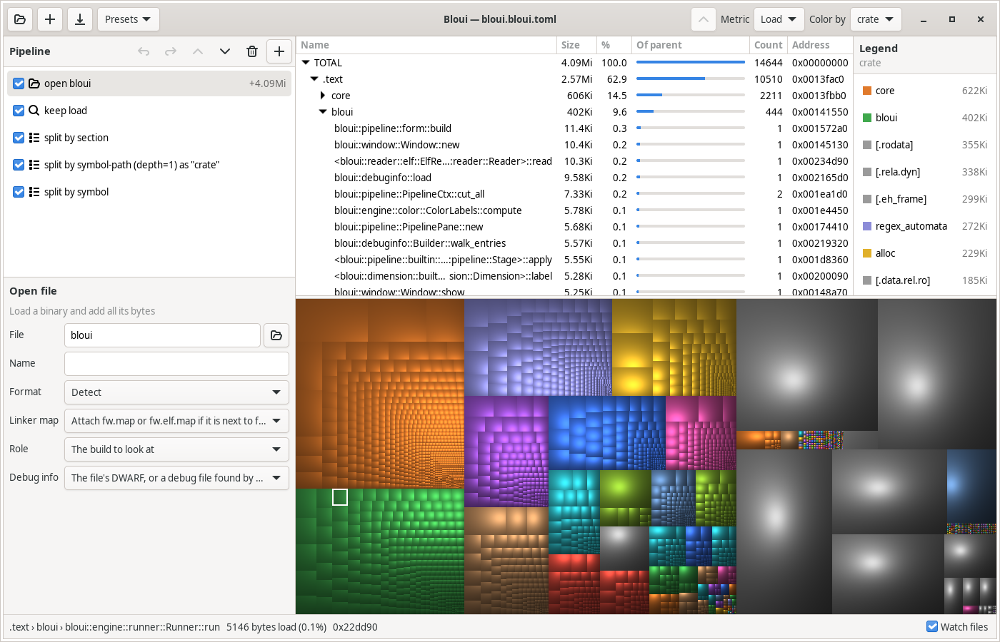

<p align="center">
  
</p>

<h1 align="center">Bloui</h1>

<p align="center">
  <b>See where the bytes in your firmware go.</b><br>
  A size analyzer for ELF files with a tree list and a cushion treemap,
  built for embedded (Cortex-M) builds first.
</p>



*Bloui looking at its own binary: by section, then crate, then symbol,
colored by crate.*

## Why Bloui

- **Treemap and tree list, side by side.** Big symbols jump out as big
  tiles. Click a tile to find it in the list; double-click to zoom in.
- **A pipeline you edit live.** Split by section, symbol, memory region,
  object file, source file and more, filter things out, and see the
  result change as you type. Undo and redo included.
- **Knows embedded builds.** Reads GNU ld linker maps: FLASH and RAM
  regions, free space, object files and archive members.
- **Reads debug info.** Compile units, source files and functions (also
  inlined ones) from DWARF, or from a separate debug file.
- **Readable names.** Demangles C++ and Rust, and groups symbols by
  namespace or crate.
- **Compare two builds.** Grown, shrunk, new and removed code in color,
  in both the list and the treemap, with a Δ column to sort by.
- **Follows your builds.** Reloads when the ELF or map file changes on
  disk.
- **Saves your views.** Project files and presets keep a pipeline and
  how to look at it.

## Also on the command line

`bloui-cli` runs the same pipelines, for scripts and CI: trees, CSV, diffs
and treemap PNGs.

```console
$ bloui-cli -i fw.elf -k load -s section -s symbol -m load -n 3
     FILE    MEMORY      LOAD      %L  section › symbol
   1.63Ki    1.63Ki    1.63Ki  100.0%  TOTAL
   1.29Ki    1.29Ki    1.29Ki   79.1%  ├─ .text
      784       784       784   47.0%  │  ├─ __udivmoddi4
      136       136       136    8.2%  │  ├─ main
      ...
```

## Getting started

The GUI needs GTK 4.14 or later (`sudo apt install libgtk-4-dev`).

```sh
git clone https://github.com/pengi/bloui
cd bloui
cargo build --release
target/release/bloui fw.elf          # a linker map fw.map next to it is found
```

Or start `bloui` empty and drop an ELF file on the window.

To get it in the application menu, with its icon:

```sh
install -Dm755 target/release/bloui target/release/bloui-cli -t ~/.local/bin
install -Dm644 data/io.github.pengi.bloui.desktop -t ~/.local/share/applications
install -Dm644 data/icons/hicolor/scalable/apps/io.github.pengi.bloui.svg \
    -t ~/.local/share/icons/hicolor/scalable/apps
```

## Documentation

Everything else is in [docs/](docs/README.md): [the GUI](docs/gui.md),
[the command line](docs/cli.md), [concepts](docs/concepts.md) and [all
stages and dimensions](docs/reference.md).

License: GPL-2.0-only, see [LICENSE](LICENSE).
